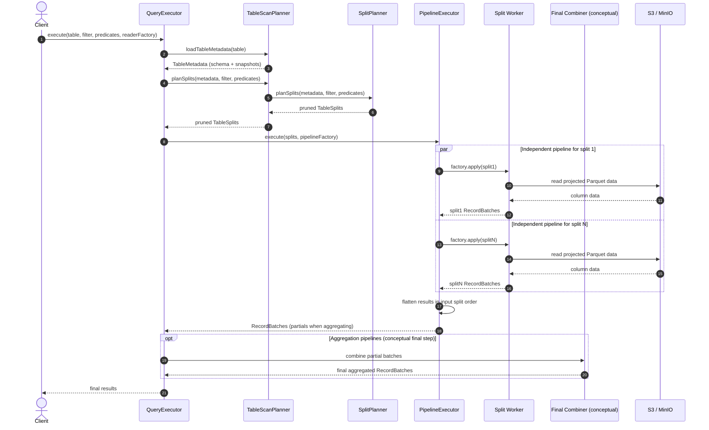

# Module 04: File Splitting and Parallel Operator Pipelines

Module 04 connects metadata pruning to real data-plane execution. Each planned `TableSplit` receives an independent operator pipeline, a bounded worker pool drains those pipelines concurrently, and the executor returns their batches in input split order.

## 1. Control Plane vs. Data Plane

* **Control Plane (`TableScanPlanner` + `SplitPlanner`)**
  * Loads versioned table metadata through `CatalogService`.
  * Resolves the active snapshot and applies partition and column-statistics pruning.
  * Produces `TableSplit` tasks without reading data files.
* **Caller Entry Point (`query.QueryExecutor`)**
  * Loads metadata once, plans splits, and wraps each split's `RowReader` in a `TableScanOperator`.
  * Delegates concurrency to `PipelineExecutor` and returns batches in split order.
* **Data Plane (`query.PipelineExecutor`, package-private)**
  * Constructs one operator pipeline per split through `Function<TableSplit, Iterator<RecordBatch>>`.
  * Executes pipelines with a bounded `ExecutorService` thread pool.
  * Flattens per-split batches in input split order.

## 2. Core Components

### A. Pipeline Factory

Uses Java's standard `Function` to create a fresh operator chain for each split:

```java
Function<TableSplit, Iterator<RecordBatch>> pipelineFactory = split -> {
    RowReader reader = createReaderFor(split);
    return new TableScanOperator(reader);
};
```

The reader owns the projection (Module 6): `TableScanOperator` mirrors `reader.getFields()` into each `RecordBatch` schema, so `createReaderFor` is where the projected `Field` list is supplied.

The factory runs **inside the worker task** because reader and operator constructors may perform I/O or prefetch. Readers and operators contain mutable iterator state, so every split owns its complete chain.

A Parquet pipeline typically contains:

```text
ParquetTableReader → TableScanOperator → optional FilterOperator → optional AggregationOperator
```

### B. `PipelineExecutor`

`PipelineExecutor` is package-private; callers reach it only through `QueryExecutor`.

```java
List<RecordBatch> execute(
    List<TableSplit> splits,
    Function<TableSplit, Iterator<RecordBatch>> pipelineFactory) throws Exception {}
```

The executor:

1. Uses a pool of `min(splitCount, maxThreads)` workers.
2. Creates and drains one pipeline per split.
3. Reads futures in submission order, even if workers finish out of order.
4. Returns one flattened `List<RecordBatch>`.

### C. Ordinary Scan, Projection, and Filtering

No separate combiner interface is needed. The executor directly returns the flattened batches:

```java
List<RecordBatch> results = queryExecutor.execute(
    tableName,
    partitionFilter,
    predicates,
    split -> createReaderFor(split)
);
```

`QueryExecutor` takes a reader factory, so the format-specific reader is supplied by the caller (Module 5 adds `ParquetTableReader`). The factory also decides projection: passing `null` reads the full schema, while a projected `Field` list is pushed down to the Parquet reader (Module 6).

### D. Aggregation: Partial Results and Conceptual Final Combine

For aggregation, each split pipeline ends with a local `AggregationOperator` (added in Module 7, once the per-split pipeline can append operators):

```java
Function<TableSplit, Iterator<RecordBatch>> factory = split -> {
    Iterator<RecordBatch> scan = new TableScanOperator(createReaderFor(split), scanFields);
    return new AggregationOperator(scan, groupByKeys, aggregations);
};
List<RecordBatch> partialBatches = scanExecutor.execute(splits, factory);
```

The current `AggregationOperator` performs only local aggregation. Final cross-split combining is intentionally conceptual in this learning lab and has no dedicated implementation class.

Final aggregation rules:

| Local aggregate | Final reduction |
|---|---|
| `SUM` | Sum partial sums |
| `COUNT` | Sum partial counts |
| `MIN` | Minimum of partial minimums |
| `MAX` | Maximum of partial maximums |

Final expressions read partial output aliases. In particular, final `COUNT` must not count partial rows.

## 3. Sequence Diagram



## 4. Verification

* `QueryExecutorTest` verifies multi-split execution end to end: it writes two Parquet files, commits a single metadata version referencing both as `DataFile`s, then runs `QueryExecutor.execute` and asserts every row from both splits is returned in split order.
* Operator tests such as `TableScanOperatorTest` and `FilterOperatorTest` cover single-pipeline behavior (projection, filtering).
* The final cross-split combining step for aggregation remains conceptual; there is no dedicated integration test for it.
