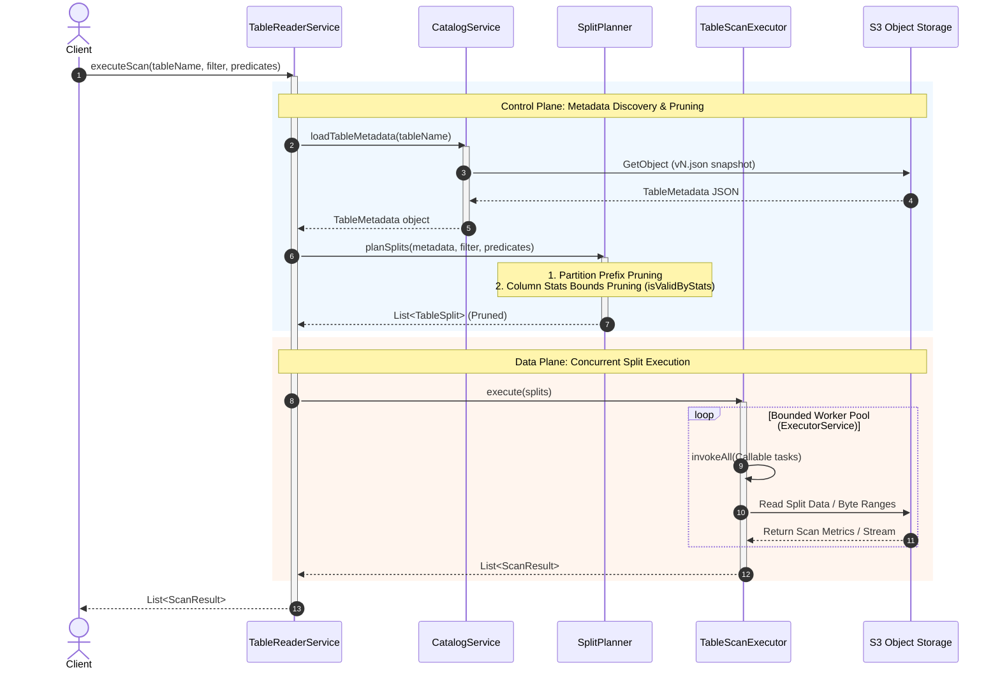

# Module 04: File Splitting and Parallel Scan Planning

Module 04 establishes the **data plane** execution architecture of the lakehouse connector. While Modules 0–3 focused on the **control plane** (catalog metadata tracking via OCC, partition pruning, and column-statistics bounding via `SplitPlanner`), Module 04 introduces concurrent task distribution and worker thread pooling to process pruned table splits in parallel.

## 1. Architectural Separation: Control Plane vs. Data Plane

In a distributed storage and query engine, responsibilities are cleanly decoupled to maintain scalability, testability, and clean code boundaries:

* **Control Plane (`TableReaderService` + `SplitPlanner`):** 
  * Operates entirely on metadata (`vN.json`).
  * Loads table snapshots, evaluates partition prefixes and min/max statistics bounds (`isValidByStats`), and produces a pruned list of `TableSplit` execution tasks without touching data files on S3.
* **Data Plane (`TableScanExecutor` + `ScanResult`):** 
  * Takes the pruned `TableSplit` objects and schedules them across worker threads using a bounded `ExecutorService` thread pool.
  * Encapsulates split metrics and execution outcomes inside `ScanResult`.

## 2. Core Components

### A. `ScanResult`
Encapsulates the performance metrics and results returned when a worker thread finishes processing an individual file split.

```java
public class ScanResult {
    private final String filePath;
    private final long recordCount;
    private final long bytesRead;
    private final long executionTimeMs;
    // Getters, constructors, and string representation...
}
```

### B. `TableScanExecutor`
Manages the parallel execution lifecycle for table splits:
* **Dynamic Pool Sizing:** Scales thread pool size based on available CPU cores and the number of active splits (`Math.min(splits.size(), maxThreads)`).
* **Parallel Dispatch:** Converts `TableSplit` items into `Callable` tasks and dispatches them via `ExecutorService.invokeAll()`.
* **Exception & Result Aggregation:** Blocks on `Future.get()` to collect results safely across all worker threads.
* **Resource Safety:** Guarantees thread pool termination using a `try-finally` block with `executor.shutdownNow()`.

```java
public List<ScanResult> execute(List<TableSplit> splits) throws Exception {}
```

### C. Updated `TableReaderService`
Acts as the primary unified facade, coordinating both control-plane planning and data-plane execution:
1. Loads table metadata version from `CatalogService`.
2. Generates pruned splits via `SplitPlanner`.
3. Dispatches the resulting splits to `TableScanExecutor` via `executeScan(...)`.

```java
public List<ScanResult> executeScan(
    String tableName, 
    String partitionFilter, 
    List<QueryPredicate> predicates) throws Exception {}
```

## 3. Sequence Diagram



## 4. Verification & Testing

Module 04 is validated via comprehensive unit tests in `TableScanExecutorTest.java`:
* **Multi-split Aggregation:** Verifies that all `TableSplit` objects are correctly processed and mapped to corresponding `ScanResult` metrics.
* **Boundary Conditions:** Confirms that empty or null split lists are handled gracefully without throwing exceptions.
* **Concurrency Scaling:** Validates thread pool behavior and execution timing under multi-threaded loads.
