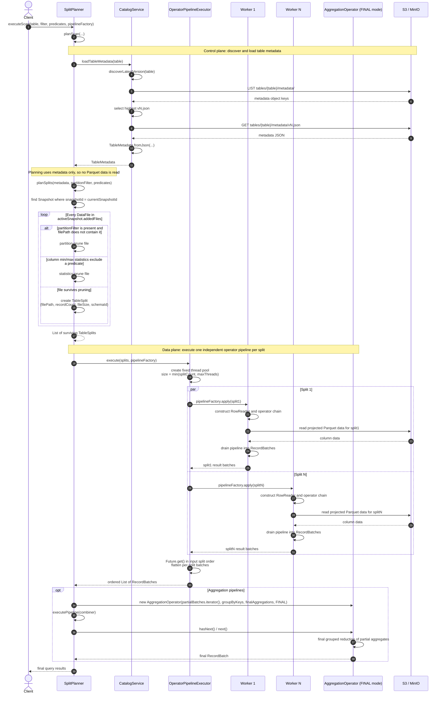
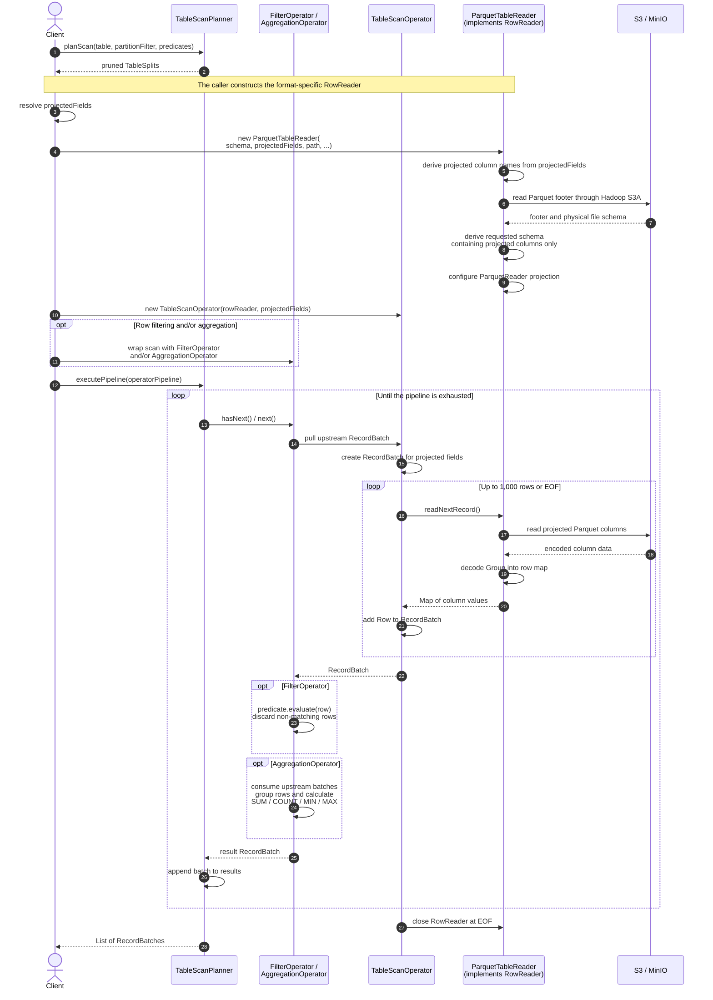
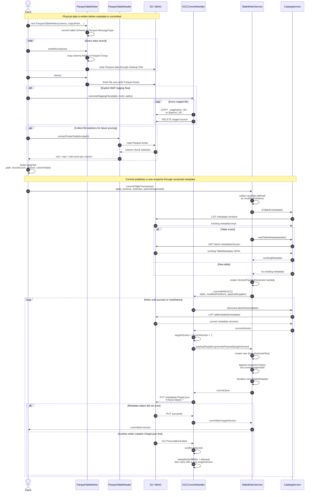

# System Diagrams

The diagrams below reflect the **current implementation**:

- `executeScan()` plans splits, runs independent operator pipelines concurrently, and returns flattened `RecordBatch` results in input split order.
- For aggregation, a final-mode `AggregationOperator` directly implements `Iterator<RecordBatch>` and reduces the partial batches.
- `executePipeline()` drains one pre-assembled operator pipeline or combiner serially.

## 1. Metadata loading, pruning, and split execution



**Pruning order:** active snapshot → partition-path filter → column min/max statistics → `TableSplit`.

For time travel, `planTimeTravelScan()` loads the requested `vX.json` directly, then performs the same planning and pruning. It returns splits without executing them.

Each split constructs its own reader and operator chain inside a worker task. The executor directly flattens ordinary results. For aggregation, partial batches are passed to a final-mode `AggregationOperator` for grouped reduction.

## 2. Real Parquet reads through the operator pipeline



The pull-based operator call flow is:

```text
TableScanPlanner.executePipeline()
    → FilterOperator / AggregationOperator
    → TableScanOperator
    → ParquetTableReader (RowReader)
    → S3 / MinIO
```

## 3. Parquet writing and optimistic metadata commit



### Key responsibilities

| Object | Responsibility |
|---|---|
| `CatalogService` | Discovers, reads, and writes versioned `vN.json` metadata. |
| `TableScanPlanner` | Orchestrates metadata loading, split planning, parallel scan execution, and pipeline consumption. |
| `SplitPlanner` | Resolves the active snapshot and converts surviving `DataFile` entries into `TableSplit` objects. |
| `OperatorPipelineExecutor` | Constructs and drains independent per-split pipelines concurrently, flattening batches in input split order. |
| `AggregationOperator` | Implements `Iterator<RecordBatch>`; `FINAL` mode merges partial aggregates across splits. |
| `RowReader` | Format-independent contract for reading one decoded record at a time. |
| `TableScanOperator` | Converts rows from an injected `RowReader` into `RecordBatch` objects. |
| `ParquetTableWriter` | Physically writes Parquet records and footers. |
| `TableWriterService` | Builds new snapshot metadata and delegates the OCC commit. It does **not** write Parquet data. |
| `OCCCommitHandler` | Atomically creates the next metadata version using `If-None-Match: *`; retries on version conflicts. |

The overall write/read relationship is:

```text
Write:
rows → Parquet file → DataFile + statistics → Snapshot → atomic vN.json commit

Read:
vN.json → active Snapshot → DataFiles → pruning → TableSplits
       → independent ParquetTableReader (RowReader) + operator pipelines
       → concatenation OR final aggregate combining
       → RecordBatches
```

Relevant implementations: `TableScanPlanner.java:46`, `SplitPlanner.java:24`, `OperatorPipelineExecutor.java:20`, `RowReader.java:12`, `TableScanOperator.java:10`, `AggregationOperator.java:14`, `TableWriterService.java:29`, and `OCCCommitHandler.java:33`.
